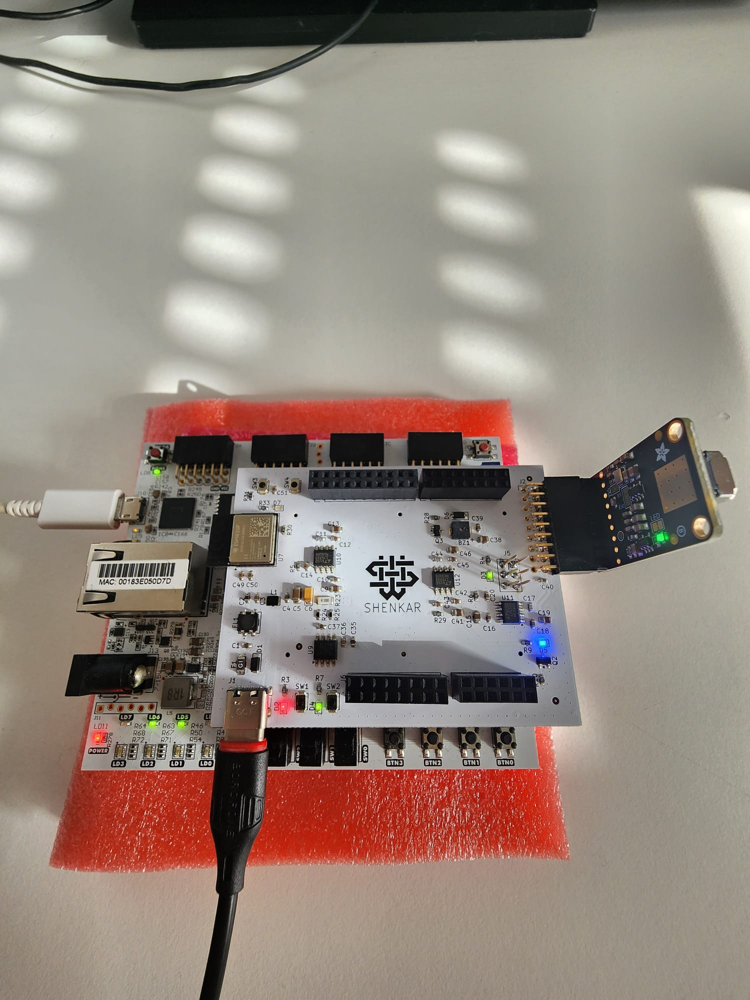
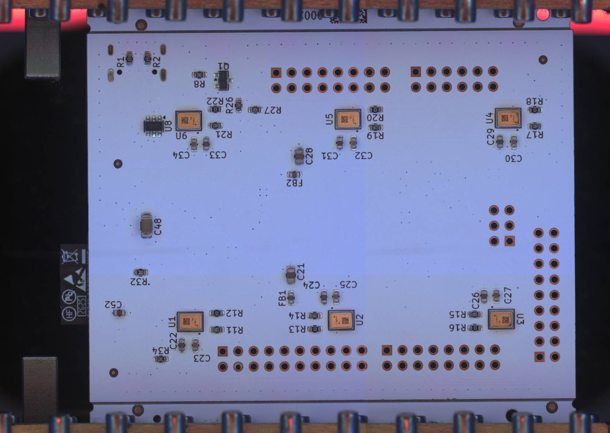
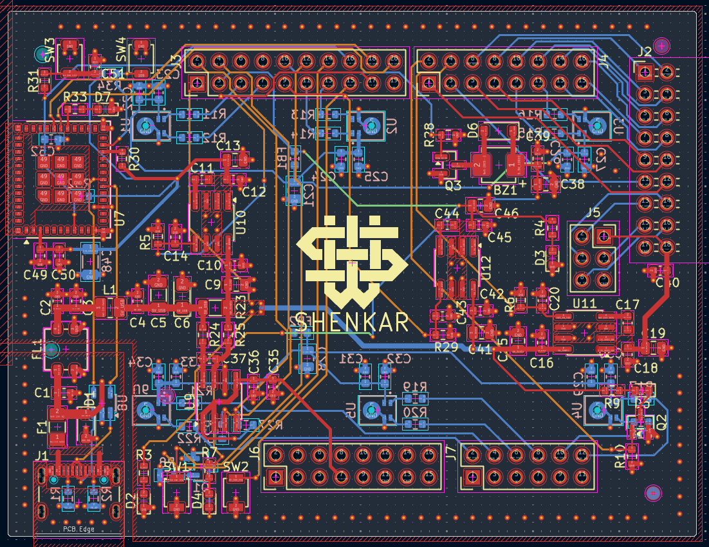
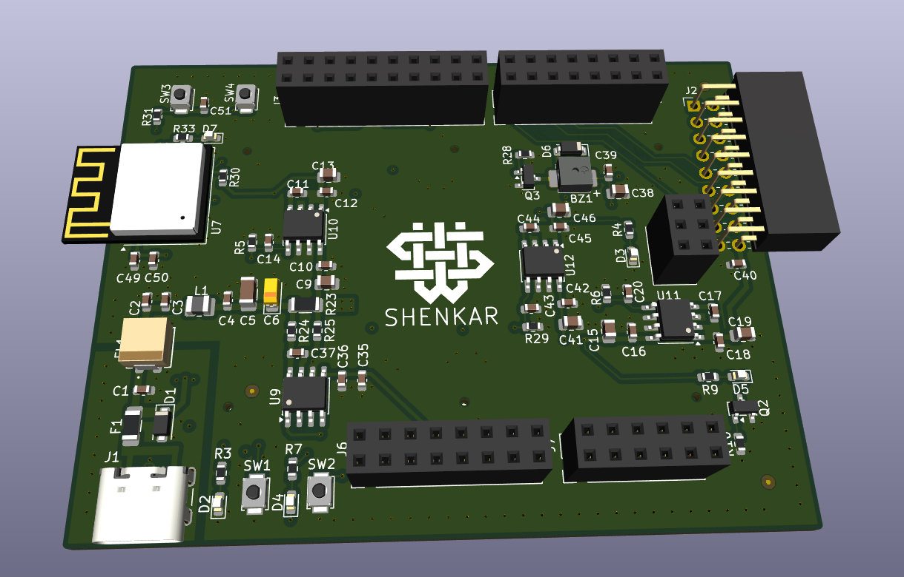

# MIPS-Based FPGA Accelerator and Custom PCB for Face and Drone Detection

A 4-layer sensor shield for the Arty A7-100T FPGA board, designed in KiCad. It is the hardware of our B.Sc. final project, which runs face and drone detection on live camera video on an Artix-7 FPGA.

Face and drone detection demo: [youtu.be/dLib91150pU](https://youtu.be/dLib91150pU)

Sound direction finding demo: [youtu.be/q1vjfgceM_w](https://www.youtube.com/watch?v=q1vjfgceM_w)

Full schematic: [Shield_Schematic_REV1.pdf](Shield_Schematic_REV1.pdf)

## Specifications

| Parameter | Value |
|---|---|
| Host board | Digilent Arty A7-100T (Artix-7) |
| PCB | 4 layers |
| Components | 124 |
| Assembly | Both sides, assembled at JLCPCB |
| Power input | USB-C |
| Status | REV1, bring-up complete |

## Hardware Design

### Power input

Power comes in through USB-C. A 0.75A resettable fuse and a TVS diode protect the input, and the USB data lines have their own ESD protection. The input then passes through an EMI filter.

### Power rails

Each 3.3V rail has its own LT1763 LDO, and the FPGA switches it on or off through a separate enable line. An INA219 measures the board current.

| Rail | Regulator | Enable signal |
|---|---|---|
| Wi-Fi | LT1763 | LDO_EN_WIFI |
| Logic | LT1763 | LDO_EN_LOGIC |
| Camera | LT1763 | LDO_EN_CAM |

### Peripherals

The board carries an ESP32-C6-MINI-1 Wi-Fi/BLE module and a header for an OV5640 camera module. Six IM73D122 PDM MEMS microphones sit on the bottom side. It also has a buzzer and four push buttons.

## Boards from JLCPCB

Top and bottom sides as delivered by JLCPCB, before the connectors were soldered.

 

## PCB Layout

## 3D view

## The project

We extended our own pipelined MIPS processor with an 8x8 systolic-array accelerator and implemented both on an Artix-7 FPGA, to run detection networks on live camera video. Face detection (YuNet) runs on every frame at up to 48 fps, and the same network, retrained on drone videos, finds a DJI Tello drone in live video.

B.Sc. final project at Shenkar, supervised by Dr. Oren Ganon.

## Team

**Michael Kochubey** designed the shield's schematic and PCB layout, and brought the board up on the Arty A7. He also wrote the FPGA interface to the OV5640 camera. [LinkedIn](https://www.linkedin.com/in/michael-kochubey-089662317/)

**Evyatar Shapira** wrote the FPGA interface to the PDM microphones and the logic of the 8x8 systolic-array accelerator. [LinkedIn](https://www.linkedin.com/in/evyatarsh/)

## License

© 2026 Michael Kochubey. All rights reserved.

The schematic and PCB layout of the shield are my own design. They are shared here for viewing only. Copying them, modifying them or using them in other designs needs my written permission.
