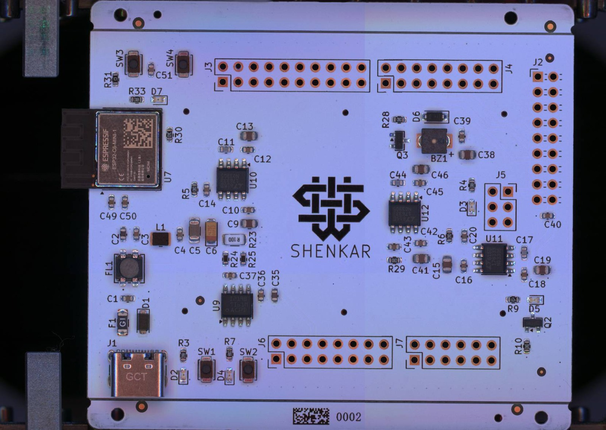

# FPGA Accelerator PCB

A 4-layer sensor shield for the Arty A7-100T FPGA board, designed in KiCad. It carries the camera, microphones and wireless hardware for our B.Sc. final project, which runs face and drone detection on live camera video on an Artix-7 FPGA.

Demo video: [youtu.be/dLib91150pU](https://youtu.be/dLib91150pU)
Full schematic: [Shield_Schematic_REV1.pdf](Shield_Schematic_REV1.pdf)

## Specifications

| Parameter | Value |
|---|---|
| Host board | Digilent Arty A7-100T (Artix-7) |
| PCB | 4 layers |
| Components | 124 |
| Assembly | Both sides, assembled at JLCPCB |
| Power input | USB-C |
| Status | REV1, brought up and working |

## Design

**Power input.** USB-C input with a 0.75A resettable fuse, a TVS diode and ESD protection on the USB data lines, followed by an EMI filter at the input.

**Power rails.** Three 3.3V LT1763 LDOs feed the Wi-Fi module, the logic and the camera. The FPGA switches each rail on and off through its own enable line, and an INA219 monitors the board current.

**Peripherals.** An ESP32-C6-MINI-1 Wi-Fi/BLE module, a header for an OV5640 camera module, and six IM73D122 PDM MEMS microphones on the bottom side. Buttons, LEDs and a buzzer complete the user interface.

## Layout

## 3D view

## The project

We extended our own pipelined MIPS processor with an 8x8 systolic-array accelerator and implemented both on the Artix-7 FPGA. Face detection (YuNet) runs on every frame at up to 48 fps, and the same network, retrained on drone videos, finds a DJI Tello drone in live video.

Joint B.Sc. project at Shenkar, supervised by Dr. Oren Ganon. My part was the hardware: the shield's schematic, layout and bring-up, and the FPGA interface to the camera.

## License

© 2026 Michael Kochubey. All rights reserved.
